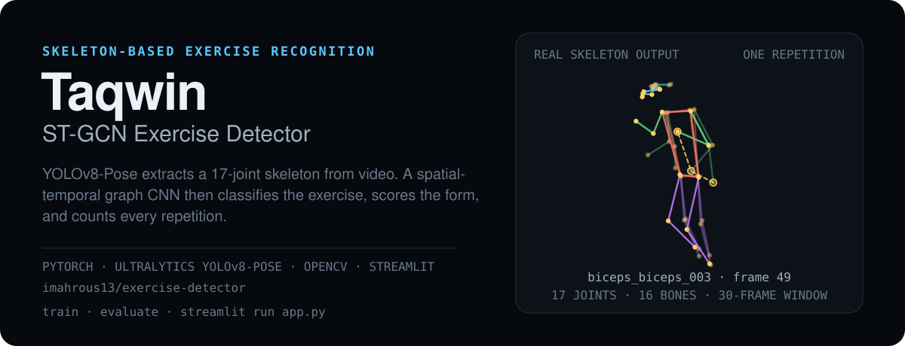
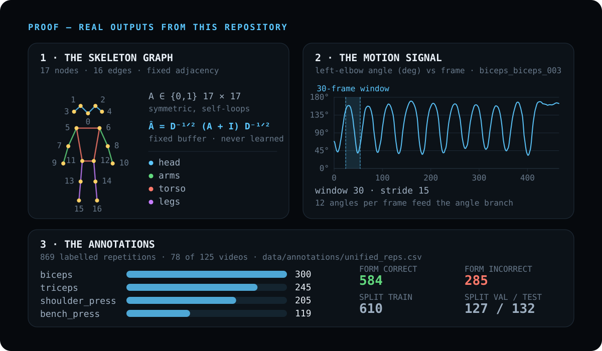

<p align="center">
  
</p>

# Taqwin ST-GCN Exercise Detector

**Skeleton-based gym exercise recognition from video.** This repository contains the
whole pipeline — pose extraction, the multi-task ST-GCN + BiLSTM model, the training and
evaluation scripts, and the Streamlit app. Every figure quoted below comes either from
the code itself or from the committed annotation file; nothing here is estimated.

| What the app reports | How it is produced |
|---|---|
| **Exercise class** + confidence | `exercise_head` — 4-way softmax over the configured classes |
| **Form score 0–100** + fault messages | rule engine (`score_form`) — angle thresholds with deduction scoring |
| **Correct / incorrect repetition count** | rule engine (`segment_reps` / `RepCounter`) — phase detection on the driver angle |

> **YOLO is not the classifier, and neither is the rule engine.** Three stages do
> different jobs: **YOLOv8-Pose** is a *perception* front-end that answers *"where are
> this person's joints?"* and never sees a class label; the **ST-GCN** is the only
> learned classifier and decides *which exercise* is being performed; the
> **deterministic rule engine** (`src/feedback/form_rules.py`) scores the form and
> counts repetitions from the joint angles. Which of the two produces which output is
> stated explicitly at every point below.

<p align="center">
  
</p>

---

## Quick start

```bash
git clone https://github.com/imahrous13/exercise-detector.git
cd exercise-detector

python -m venv .venv && .venv\Scripts\activate      # Linux/macOS: source .venv/bin/activate
pip install -r requirements.txt
```

Then, in order:

```bash
# 1. extract poses + create the train/val/test splits
python scripts/prepare_data.py --video_dir "path/to/gym videos" --config configs/default.yaml

# 2. train (GPU strongly recommended)
python scripts/train.py --config configs/default.yaml

# 3. evaluate on the held-out test split
python scripts/evaluate.py --checkpoint checkpoints/best.pt --config configs/default.yaml

# 4. run the app
streamlit run app.py
```

A Google Colab notebook is included for GPU-only machines: `train_colab.ipynb`.

### ⚠️ You need a trained checkpoint before the app will start

`app.py` loads `checkpoints/best.pt` and **that file is not in this repository** —
`checkpoints/` is git-ignored, and the raw videos are not published either. The app
raises `FileNotFoundError` on first use until you produce a checkpoint with step 2 (or
copy one from a machine where training was run).

A checkpoint from an older two-head model still loads (non-strictly); the app then
reports **0 repetitions** because no `rep_head` weights are present.

---

## How it works

<p align="center">
  
</p>

| Stage | Where it happens |
|---|---|
| 1. Frame capture | `cv2.VideoCapture` — file or webcam |
| 2. Person detection | `PoseExtractor._detect_all()` — YOLOv8-Pose, all persons |
| 3. Keypoint extraction | 17 COCO joints, `[x, y, confidence]` per joint |
| 4. Tracking & selection | ByteTrack (video) / IoU match (webcam); largest person as fallback |
| 5. ROI crop | bbox padded by 20 %; pose re-run on the crop |
| 6. Temporal smoothing | EMA, α = 0.35 (x/y blended, confidence = running max) |
| 7. Normalisation | hip-centred, then scaled by torso length |
| 8. Skeleton features | `x, y, confidence, vx, vy, bone_length` → `(T, 17, 6)` |
| 9. Joint angles | 12 angles per frame → `(T, 12)` |
| 10. Sliding windows | 30 frames, stride 15 |
| 11. ST-GCN | 4 blocks: 64 → 128 → 256 → 512 |
| 12. BiLSTM | 2 layers × 256, bidirectional → mean pool over time |
| 13. Model output | exercise `(B,4)` → class + confidence. The form and rep heads are trained but **not used at inference** |
| 14. Form & rep analysis | rule engine — `score_form()` gives the 0–100 score and the fault messages; `segment_reps()` / `RepCounter()` count the repetitions |
| 15. Output | skeleton overlay, metrics, annotated H.264 video |

---

## Supported exercise classes

The class list is **defined in `configs/default.yaml`** under `data.exercises`. The
order is significant — it defines the class index used everywhere (split CSVs, label
files, model outputs).

| Index | Config class name | Human-readable name | Raw-video folder |
|---|---|---|---|
| 0 | `bench_press` | Bench Press | `bench press` |
| 1 | `biceps` | Biceps Curl | `biceps` |
| 2 | `shoulder_press` | Shoulder Press | `shoulder press` |
| 3 | `triceps` | Triceps Extension / Pushdown | `triceps` |

**Only these four classes are configured, trained and predicted by this project.**

* `src/feedback/form_rules.py` contains a much larger library of deterministic scoring
  rules (squat, deadlift, plank, lunges, lat pulldown …). Those are **not** model
  classes — they are rule-engine functions that supply training labels.
* `scripts/datasets/utils.py` defines a `CANONICAL_EXERCISES` list of ~30 names used
  only to *normalise* external-dataset label spellings; anything outside the four
  configured classes is dropped by the adapters.
* The class list is data-driven: changing `data.exercises` changes `num_exercises` and
  re-indexes the whole pipeline.

---

## Why skeleton-based exercise recognition?

A human body has a small, stable and highly structured kinematic topology, which makes
it naturally graph-representable:

| Physical concept | Graph concept | In this repository |
|---|---|---|
| A joint (shoulder, elbow, knee …) | **Node** | 17 COCO keypoints (`V = 17`) |
| An anatomical bone / connection | **Edge** | 16 undirected COCO edges |
| Consecutive video frames | **Temporal edge** | the time axis of the 30-frame window |

Two properties make this attractive for exercise analysis:

1. **Appearance invariance.** Exercise identity is defined by *how the joints move
   relative to each other*, not by texture, clothing, lighting or background. A
   normalised skeleton removes most of the nuisance variation that dominates raw-video
   classification.
2. **Physical priors come for free.** Because the graph encodes anatomy, a spatial
   convolution is a learned local aggregation over physically connected body parts —
   not an arbitrary mixing of pixels.

A plain 3-D CNN over a skeleton tensor would have to *learn* the body topology and
would treat distant-but-related joints (left wrist ↔ right wrist) as unrelated. ST-GCN
instead **fixes the adjacency matrix to the human skeleton** and learns only the
feature transform, so the model starts from the correct inductive bias. Its temporal
convolution then models how those joint relationships evolve across frames, which is
what distinguishes a half-completed repetition from a full one.

---

## Deep dive

### Pose extraction — `src/pose_extraction/extractor.py`

`PoseExtractor` is the single entry point for all skeleton acquisition.

```python
PoseExtractor(
    model_size='s',             # → YOLO("yolov8s-pose.pt")
    confidence_threshold=0.5,   # minimum mean hip confidence to accept a frame
    smoothing_alpha=0.35,       # EMA blend factor (0 disables smoothing)
    roi_padding_ratio=0.2,      # 20 % padding around the bbox before cropping
)
```

| Aspect | Implementation |
|---|---|
| Pose model | `YOLO(f'yolov8{model_size}-pose.pt')`; `pose.model_size: s` → `yolov8s-pose.pt` |
| Skeleton | 17 COCO keypoints, `[x, y, confidence]` per joint |
| Confidence | YOLO keypoint confidence in `[0, 1]`; a frame is accepted only if the **mean confidence of hips (11, 12) ≥ `confidence_threshold`** |
| Bounding boxes | derived from keypoints with `conf > 0.1` (`_bbox_from_keypoints`); the detector's own `boxes.xyxy` is used in the ByteTrack path |
| Multiple people | all detections are returned (`_detect_all`); the tracked person is chosen by track ID (video) or IoU (webcam), otherwise the **largest bbox** wins |
| ROI / crop | `_crop_to_roi()` pads the bbox by `roi_padding_ratio` and clamps to the image; pose is re-run on the crop and keypoints are returned in **crop space**; the crop offset is returned so callers can restore full-frame coordinates |
| EMA smoothing | `_smooth_keypoints_ema()` for whole sequences; a `_prev_keypoints` blend for the live path |
| Video output | `extract_from_video()` → `(T, 17, 3)` + fps; `extract_from_video_with_frames()` → additionally the original BGR frames and per-frame `(T, 2)` crop offsets |
| Manual selection | `select_person_at(frame, x, y)` picks the person under a click (fallback: nearest bbox centre) |

Key detail for reproducibility: **keypoints that reach the model are in crop/ROI
space**, not full-frame. Because the model immediately hip-centres and scale-normalises
the skeleton, this is consistent between training and inference and makes the model
robust to where the person stands in frame. The app adds the stored crop offsets back
before drawing.

---

### Skeleton preprocessing — `src/preprocessing/normalize.py`

```python
preprocess_skeleton(keypoints)  # (T,17,3) raw
    → normalized_keypoints (T, 17, 3)
    → angles              (T, 12)
```

#### Coordinate normalisation

1. **`recenter_skeleton()`** — the hip centre (midpoint of joints 11 and 12) is
   subtracted from every joint. The confidence channel is preserved.
2. **`normalize_scale()`** — the per-frame torso length (`‖mid_shoulder − mid_hip‖`)
   divides `x` and `y`, making the representation invariant to the subject's distance
   from the camera and to their body size. Degenerate frames fall back to the previous
   frame's torso length (or `1.0`).

After both steps the skeleton is expressed in **torso lengths relative to the hip
centre** — the coordinate frame in which all the biomechanical rules are written.

#### Temporal information

Temporal information enters the model through two channels:

* **Velocity** — channels 3 and 4 of the 6-channel feature tensor are the first
  differences of the normalised `x` and `y` (`compute_extra_features`). The first
  frame's velocity is copied from frame 1 to avoid a zero-initialised artefact.
* **The ST-GCN temporal convolution and the BiLSTM** operate over the time axis
  themselves, so motion is modelled *implicitly* on top of the explicit velocity
  channels.

#### Confidence channel

`confidence` is the third channel of the raw skeleton and is carried through
normalisation unchanged, so the network can learn to discount unreliable joints. The
skeleton overlay uses the same confidence with a 0.3 drawing threshold.

#### The 12 computed joint angles

`ANGLE_DEFINITIONS` — each angle is measured **at the middle joint** of a triple
`(a, b, c)` using the arccosine of the angle between `a−b` and `c−b`, in degrees,
range `[0, 180]`. Angles are computed from the **original (pre-normalisation)
coordinates**, which is equivalent for an angle but avoids any numerical effect from
the scale division.

| Idx | Angle | Vertices (a–b–c) | Index triple |
|---|---|---|---|
| 0 | L-Shoulder | Hip–Shoulder–Elbow | (11, 5, 7) |
| 1 | R-Shoulder | Hip–Shoulder–Elbow | (12, 6, 8) |
| 2 | L-Elbow | Shoulder–Elbow–Wrist | (5, 7, 9) |
| 3 | R-Elbow | Shoulder–Elbow–Wrist | (6, 8, 10) |
| 4 | L-Hip | Shoulder–Hip–Knee | (5, 11, 13) |
| 5 | R-Hip | Shoulder–Hip–Knee | (6, 12, 14) |
| 6 | L-Knee | Hip–Knee–Ankle | (11, 13, 15) |
| 7 | R-Knee | Hip–Knee–Ankle | (12, 14, 16) |
| 8 | L-Trunk | Knee–Hip–Shoulder | (13, 11, 5) |
| 9 | R-Trunk | Knee–Hip–Shoulder | (14, 12, 6) |
| 10 | L-Ankle | Hip–Ankle–Knee | (11, 15, 13) |
| 11 | R-Ankle | Hip–Ankle–Knee | (12, 16, 14) |

Convention used throughout the rule engine: **180° = fully extended/straight,
90° = a right angle**.

#### Additional skeleton features

The only additional features are the **bone length to parent** (channel 5, using the
COCO parent list) and the **velocity** channels above. There are no optical-flow,
appearance or depth features in the model.

---

### Graph representation — `src/models/graph_conv.py`

#### Nodes

`V = 17` — the COCO-17 keypoints. `NUM_JOINTS = 17` and `model.num_joints: 17` in
the config.

#### Edges

`COCO_EDGES` defines **16 undirected anatomical connections**:

| Region | Edges |
|---|---|
| Head | (0,1) (0,2) (1,3) (2,4) |
| Shoulders | (5,6) |
| Arms | (5,7) (7,9) (6,8) (8,10) |
| Torso | (5,11) (6,12) (11,12) |
| Legs | (11,13) (13,15) (12,14) (14,16) |

The identical list is reused for drawing the overlay
(`src/utils/visualization.py: SKELETON_CONNECTIONS`).

#### Adjacency matrix construction

`build_adjacency_matrix(edges=None, num_joints=17, self_loops=True, normalize=True)`:

1. Build a zero `17 × 17` matrix; for every edge set `A[src, dst] = A[dst, src] = 1`
   (the graph is **undirected**, so the matrix is symmetric).
2. **Self-connections**: `A += I` — each joint keeps its own features.
3. **Symmetric normalisation**: `Â = D^{-1/2} A D^{-1/2}` where `D = diag(A · 1)`.
   `D^{-1/2}` entries of `inf` (isolated nodes) are set to `0`.

The result is a `torch.FloatTensor` of shape `(17, 17)`, registered as a **non-learnable
buffer** (`self.register_buffer('adj', adj)`) on the model, so it travels with the
checkpoint and `.to(device)` but is never optimised.

#### Spatial graph convolution

`GraphConvolution` implements

```
X' = Â · (X · W) + b
```

for `X ∈ ℝ^{B×T×V×C_in}` and `W ∈ ℝ^{C_in×C_out}`:

```python
support = torch.matmul(x, self.weight)                      # (B, T, V, C_out)
output  = torch.einsum('vw,btwc->btvc', adj, support)       # (B, T, V, C_out)
output  = output + self.bias
```

`W` is initialised with Xavier uniform; the bias is zero-initialised.

> **Implementation note (differs from the original paper).** The published ST-GCN
> partitions the edge set into *k* subsets (self / inward / outward) and aggregates them
> with a learnable subset embedding. This repository implements a **single-subset
> variant**: one fixed normalised adjacency matrix and one shared linear transform per
> layer. The spatial prior is the same (anatomical adjacency); the subset-embedding
> mechanism of the original paper is **not** implemented here.

---

### ST-GCN architecture — `src/models/stgcn.py`

`STGCNBlock(in_channels, out_channels, kernel_size=9, stride=1, dropout=0.4)` operates
on channels-first tensors `(B, C, T, V)` and returns `(B, C_out, T, V)`.

A block performs, in order:

| Stage | Operation | Details |
|---|---|---|
| 1. Residual branch | `1×1 Conv2d` + `BatchNorm2d` | used when `in_channels ≠ out_channels`; otherwise `nn.Identity()` |
| 2. Spatial graph convolution | `GraphConvolution` | `Â · (X·W) + b` over the 17 joints |
| 3 | `BatchNorm2d` | over the channel dimension |
| 4 | `ReLU(inplace=True)` | |
| 5. Temporal convolution | `BatchNorm2d → ReLU → Conv2d(k=(9,1), stride=(1,1), padding=(4,0)) → BatchNorm2d → Dropout` | `kernel_size=9` mixes 9 consecutive frames **per joint**; the joint dimension is untouched (`k=(9,1)`) |
| 6. Residual add + activation | `out = ReLU(x_tcn + residual)` | |

The `1×1` spatial kernel and the `k=(9,1)` temporal kernel keep the spatial and
temporal factorisation explicit: spatial mixing happens only through the graph
convolution, temporal mixing only through the 2-D convolution.

#### Configured channel progression

```yaml
model:
  num_joints: 17
  in_channels: 6
  gcn_channels: [64, 128, 256, 512]   # 4 ST-GCN blocks
  tcn_kernel_size: 9
```

| Block | In → Out | Params (approx.) |
|---|---|---|
| 1 | 6 → 64 | 38 K |
| 2 | 64 → 128 | 165 K |
| 3 | 128 → 256 | 658 K |
| 4 | 256 → 512 | 2.63 M |
| **ST-GCN total** | | **≈ 3.49 M** |

Parameter counts are summed analytically from the configured layer widths; the
`~6.88 M` figure quoted in the notebook header predates the current configuration.

---

### Joint-angle branch

`ExerciseSTGCN.angle_branch` is a small per-frame MLP:

```
Linear(12 → 64) → ReLU(inplace) → Dropout(0.4) → Linear(64 → 64) → ReLU(inplace)
```

* **Input**: `(B, T, 12)` — the 12 joint angles in degrees.
* **Output**: `(B, T, 64)` — `angle_hidden = 64` in the config.
* The branch is **frame-wise** (a per-timestep MLP, not a sequence model); the temporal
  aspect is handled downstream by the BiLSTM.
* If `angles is None` is passed to `forward()`, a zero tensor of the right shape is
  substituted — the model degrades gracefully to a pure skeleton model.

**Why fuse them with the learned graph features?** Joint angles are *human-readable
biomechanical quantities* (elbow flexion, trunk inclination, range of motion). The
graph convolution learns arbitrary spatial filters over joint coordinates and is not
interpretable as "elbow angle". Concatenating the two gives the BiLSTM a
representation that generalises better across subjects — because angles are normalised
to the body rather than to pixel space — and a feature the rule engine and the learned
model agree on, which is what makes the hybrid labelling scheme coherent.

**It is not a separate classifier.** The angle branch produces features only; there is
no angle-only head. All three prediction heads read the *fused* representation.

---

### BiLSTM temporal modelling

```python
self.bilstm = nn.LSTM(
    input_size = gcn_channels[-1] + angle_hidden,   # 512 + 64 = 576
    hidden_size = lstm_hidden,                      # 256
    num_layers  = lstm_layers,                      # 2
    batch_first = True,
    bidirectional = True,
    dropout = dropout if lstm_layers > 1 else 0,    # 0.4 between the 2 layers
)
```

| Property | Value |
|---|---|
| Input size | `576` (512 GCN + 64 angle) |
| Hidden size | `256` per direction |
| Layers | `2` |
| Bidirectional | yes |
| Output shape | `(B, 30, 512)` (`256 × 2`) |
| **Temporal pooling** | **mean over the time axis** → `(B, 512)` |

**Why a BiLSTM after the ST-GCN?** The ST-GCN already convolves over time, but its
temporal receptive field is local (a stack of 4 blocks with `k=9` kernels) and it
aggregates *per joint* before joint-pooling. The BiLSTM models **sequence-level
dynamics of the whole body after fusion**:

* a repetition is a *cycle* — the model must recognise a return-to-start pattern, not
  just a local extreme;
* a rep head that fires "a rep completed in this window" needs evidence from the
  *end* of the window, which the **backward** direction supplies directly, while the
  forward direction supplies the *start*;
* the LSTM state carries order information that a mean-pooled graph feature cannot
  express.

The final **mean pooling over time** produces a single fixed-size vector per window
regardless of window length, which is what allows one dense layer per head.

---

### Multi-task prediction heads

All three heads read the same pooled feature vector `(B, 512)`.

#### Exercise classification

```
Linear(512 → 128) → ReLU(inplace) → Dropout(0.4) → Linear(128 → 4)
```

* Output `(B, 4)` logits over `bench_press, biceps, shoulder_press, triceps`.
* The softmax maximum is reported as the confidence in the UI.
* **Labels**: the exercise index stored in the split CSV (`data/splits/*.csv`, column
  `exercise`), assigned from the source folder name by `prepare_data.py` using the
  config-driven folder → class mapping.

#### Form quality

```
Linear(512 → 64) → ReLU(inplace) → Dropout(0.4) → Linear(64 → 2)
```

* Output `(B, 2)` logits — class `0` = incorrect, class `1` = correct.
* **This head is trained but not consulted at inference.** The 0–100 form score and the
  correct/incorrect flag the app shows come from the deterministic rule engine
  (`get_form_summary()` → `score_form()`), which is applied to the window's joint
  angles. See [Rule-based form feedback](#rule-based-form-feedback).
* **How the labels are obtained** (`src/data/annotations.py: label_window_from_reps`):
  * A window that overlaps one or more annotated repetitions takes the `form_label`
    of the **annotated rep with the largest frame overlap**.
  * A window with **no** rep overlap gets `form_valid = False` and is **excluded from
    the form loss** (masked in `MultiTaskLoss`).
  * `form_label` is parsed from the annotation CSV as `1`/`0` or the strings
    `correct` / `incorrect` (`_parse_form_label`).
  * For videos with **no** manual annotation rows, the label falls back to the
    deterministic rule engine (`segment_reps()` + `score_form()`), tagged `rules_auto`.

#### Rep detection

```
Linear(512 → 64) → ReLU(inplace) → Dropout(0.4) → Linear(64 → 2)
```

* Output `(B, 2)` logits — class `0` = *no* rep completed in this window, class `1` =
  a rep completed in this window.
* **Labels**: `rep_label = 1` when the window overlaps at least one annotated
  repetition (same overlap routine as the form head), `0` otherwise.
* **This head is trained but not consulted at inference.** Repetitions are counted by
  the rule engine's phase detector (`segment_reps()` for video, `RepCounter` for the
  webcam). The `use_rep_head` flag is still computed when the checkpoint is loaded, so
  an older two-head checkpoint still loads — but it no longer changes the output.

#### Training vs. runtime behaviour

| | Training | Deployed app / CLI inference |
|---|---|---|
| Exercise head | trained, cross-entropy | **used** for the reported class + confidence |
| Form head | trained, loss masked by `form_valid` | computed but **not used** — the rule engine decides the form |
| Rep head | trained, cross-entropy | computed but **not used** — the rule engine counts the reps |
| Rule engine | **generates labels** for unannotated videos | **also runs at inference** — form score, fault messages, rep count |

All three heads are trained jointly with the uncertainty-weighted loss, but only the
exercise head reaches the user. The form and rep heads are effectively shadowed at
runtime; see [Limitations](#limitations) for what that costs.

---

### Rule-based form feedback

This distinction is central to the project and is kept explicit in the codebase.

#### Produced by the ST-GCN model

* the **exercise class** and its confidence (`exercise_head`) — the only model output
  that reaches the user,
* the binary correct/incorrect form decision (`form_head`) — trained, but not used at
  inference,
* whether a repetition was completed in the window (`rep_head`) — trained, but not
  used at inference.

#### Produced by the deterministic rule engine (`src/feedback/form_rules.py`)

* a **0–100 deduction score** computed from angle statistics (min/max/mean/range per
  angle, bilateral averages, left/right asymmetry),
* **human-readable fault messages** such as *"Not going deep enough — lower bar to
  chest"*, *"Excessive back lean — keep torso more upright"*, *"Arms uneven — press
  symmetrically"*,
* the **correct / incorrect repetition count** (`segment_reps()` for video,
  `RepCounter` for the webcam).

Each exercise has its own scorer with explicit angle thresholds, a deduction table and
a pass threshold (`_PASS_THRESHOLDS`, e.g. `60` for most exercises). The four
configured classes map onto the engine as:

| Config class | Rule function | Rep driver angle |
|---|---|---|
| `bench_press` | `_score_bench_press` | elbow (idx 2), 100°→155° |
| `biceps` | `_score_barbell_biceps_curl` | elbow (idx 2), 60°→140° |
| `shoulder_press` | `_score_shoulder_press` | shoulder (idx 0), 100°→160° |
| `triceps` | `_score_tricep_pushdown` | elbow (idx 2), 40°→90° |

**These rules are not neural-network predictions.** They are hand-specified thresholds
evaluated on the angle stream — but they are what the application actually uses. The
rule engine runs in two places: at **inference** (form score, fault messages, rep
count) and at **label-generation** time (for videos with no manual annotation). Its
public API is `score_form()`, `assess_form()`, `get_form_summary()`, `segment_reps()`
and `RepCounter`.

#### Label fallback behaviour (from the config)

```yaml
data:
  labeling:
    source: unified                                   # use data/annotations/unified_reps.csv
    annotations_file: data/annotations/unified_reps.csv
    fallback_to_rules: true                           # rule scoring for videos not in the CSV
```

`src/data/labeling.py:get_video_reps()` implements the priority chain per video:

1. **Manual** annotation rows exist → they are used, tagged `manual`.
2. **Otherwise**, if `fallback_to_rules` is enabled and the video has an angle file →
   `reps_from_rules()` calls `segment_reps()` and scores each rep with `score_form()`,
   tagged `rules` (mistake type `rules_auto`).
3. **Otherwise** the video contributes no rep labels (tagged `none`); all of its windows
   get `rep = 0` and `form_valid = False`, so its form supervision is masked out and it
   only trains the exercise head.

Setting `source: manual` makes a populated annotation file mandatory and raises
`FileNotFoundError` otherwise.

#### Why the rules, and not the trained form head

The rule engine was moved into the inference path deliberately: the form and rep heads
were judged too weak to be trusted for a per-window verdict, whereas the angle
thresholds are interpretable, inspectable, and easy to tune per exercise. The trade-off
is that the app's form score no longer reflects what the network learned for the form
task — see [Limitations](#limitations).

---

### Repetition counting

The project contains **two** repetition-counting mechanisms. The **rule-based** one is
what the application uses; the **model-head** one is trained and computed but no longer
consulted.

#### 1. Rule / state-machine based (used by the deployed app and CLI)

**Video / CLI** — `scripts/inference.py` segments the *whole clip* once and then
attributes the segments to windows:

```python
dominant_idx = Counter(w['exercise_pred'] for w in windows_data).most_common(1)[0][0]
rep_exercise = names[dominant_idx]
rep_segments = segment_reps(rep_exercise, angles)        # over the full T×12 angle array

for w in windows_data:
    form_info = get_form_summary(w['exercise_pred'], w['window_angles'], names)
    end_frame = w['end'] - 1
    c_reps = sum(1 for seg in rep_segments if seg[2] == 1 and seg[1] <= end_frame)
    i_reps = sum(1 for seg in rep_segments if seg[2] == 0 and seg[1] <= end_frame)
```

* `segment_reps()` is a debounced two-phase state machine
  (`extended → contracted → extended`) over a per-exercise "driver" angle
  (`REP_PHASES`), with `REP_DEBOUNCE_FRAMES = 3`. It returns
  `(start_frame, end_frame, is_correct, score)` per repetition, where `is_correct`
  comes from `score_form()` on that rep's angle window.
* The exercise used for segmentation is the **majority vote** across all windows, so
  one misclassified window cannot switch the rep detector to the wrong driver angle.
* The counts shown for a window are **cumulative**: every segment whose end frame has
  already passed the window end is counted, so the number only grows as the clip
  progresses.

**Live webcam** — `app.py` uses the streaming variant `RepCounter` instead, driven
per frame:

```python
rep_angle = get_rep_angle(current_exercise, frame_angles, 0)
form_info_frame = get_form_summary(ex_idx, frame_angles, config_ex_names)
rep_counter.update(current_exercise, rep_angle, form_info_frame['is_correct'])
```

`RepCounter` holds the same two-phase state (`EXTENDED → CONTRACTED → EXTENDED`), and
a rep is filed as correct or incorrect using the rule engine's verdict at the moment
the rep completes. Live rep counting starts only after the model has classified the
first window, because the driver angle depends on the detected exercise.

#### 2. Model-head based (trained, computed, not used at inference)

The `rep_head` still predicts "a rep completed in this window" and is trained with the
multi-task loss, and the inference code still loads it:

```python
use_rep_head = any(k.startswith('rep_head') for k in state)
model.load_state_dict(state, strict=use_rep_head)   # older 2-head checkpoints still load
```

but the runtime no longer reads `rep_logits` — `run_inference()` documents the
`use_rep_head` argument as *"ignored — reps are counted via angle-based rules
(`segment_reps`)"*, and `app.py` does the same. A checkpoint without a `rep_head` still
loads and behaves identically, because the counts never came from it.

#### 3. A third, offline segmentation engine

`src/data/auto_reps.py` is a separate, more conservative segmentation engine
(robust-percentile adaptive thresholds, per-video quality gates, per-rep confidence,
elbow-angle turning-point anchoring in `scripts/segment_reps_simple.py`). It is used
by the annotation tooling — `scripts/auto_segment_reps.py` and
`scripts/auto_label_unannotated.py` — to *propose* rep boundaries for a human to
review, not to count reps in the running app.

---

### Model input and output

| Tensor | Shape | Description |
|---|---|---|
| Raw keypoints (single frame) | `(17, 3)` | `[x, y, confidence]` in crop/ROI space |
| Raw keypoint sequence (video) | `(T, 17, 3)` | all accepted frames of a video |
| Normalised skeleton (on disk) | `(T, 17, 3)` | hip-recentred, torso-scaled, confidence kept |
| Joint angles | `(T, 12)` | degrees, `ANGLE_DEFINITIONS` order |
| **Model input — skeleton** | **`(B, 30, 17, 6)`** | `x, y, conf, vx, vy, bone_len` |
| **Model input — angles** | **`(B, 30, 12)`** | biomechanical angle features |
| GCN activation (per block) | `(B, C_out, 30, 17)` | channels-first |
| After joint pooling | `(B, 30, 512)` | mean over the 17 joints |
| Angle-branch output | `(B, 30, 64)` | fused angle features |
| Fused LSTM input | `(B, 30, 576)` | `concat([GCN, angles], dim=2)` |
| BiLSTM output | `(B, 30, 512)` | `256 × 2` (bidirectional) |
| Pooled representation | `(B, 512)` | mean over the 30 time steps |
| **Exercise logits** | **`(B, 4)`** | `bench_press, biceps, shoulder_press, triceps` |
| **Form logits** | **`(B, 2)`** | `0 = incorrect`, `1 = correct` |
| **Rep logits** | **`(B, 2)`** | `0 = no rep in window`, `1 = rep in window` |

`B = 32` during training (`training.batch_size`), `B = 1` during inference;
`T = 30` (`data.window_size`).

At inference only the exercise logits are read. The form and rep logits are still
computed by the forward pass, but the runtime uses the rule engine's output instead —
see [Rule-based form feedback](#rule-based-form-feedback).

---

## Training

### Data loading

`create_dataloaders()` (`src/data/dataset.py`) builds one `SkeletonDataset` per split:

* **Split CSVs** — `data/splits/{train,val,test}.csv`, columns `filename, exercise`,
  produced by `scripts/prepare_data.py`.
* **Skeleton files** — `data/processed/skeletons/<video>.npy` `(T, 17, 3)` and
  `<video>_angles.npy` `(T, 12)`.
* **Stride** — train uses `data.stride = 15` (50 % overlap); validation and test use
  `window_size = 30` (non-overlapping), so evaluation windows are independent.
* **Augmentation** — enabled for the train split only.
* **Class-balanced sampling** — `WeightedRandomSampler` with inverse-frequency
  weights when `training.class_balanced_sampling` is true (it is); `shuffle` is then
  disabled because the sampler does the shuffling.
* `drop_last=True` for the train loader, `pin_memory=True`.

#### Window generation and labelling

For each video, sliding windows of 30 frames are created and each window is labelled
by `label_window()`:

* `rep_label` = 1 if the window overlaps any labelled rep.
* `form_label` = the form label of the **best-overlapping** rep; `form_valid = False`
  when no rep overlaps (masked out of the form loss).
* `mistake_type` and `label_source` (`manual` / `rules` / `none`) are carried along for
  inspection.

### Loss function

`src/training/losses.py: MultiTaskLoss` — **uncertainty-weighted multi-task loss**
(Kendall et al., CVPR 2018):

```
L = e^{−s₁}·L_exercise + s₁  +  e^{−s₂}·L_form + s₂  +  e^{−s₃}·L_rep + s₃
```

with three learnable log-variance parameters `s = log_vars` (initialised to 0). The
model therefore *learns* the relative weight of the three objectives during training.

* `L_exercise` — `CrossEntropyLoss` with **inverse-frequency class weights**
  (`total / (num_classes × count)`, `training.exercise_class_weights: true`) and
  **label smoothing 0.1** (`training.label_smoothing`).
* `L_form` — `CrossEntropyLoss` evaluated **only on windows where `form_valid` is
  true**; if no window in the batch is valid, the form term is exactly `0`.
* `L_rep` — plain `CrossEntropyLoss`.

### Optimiser, schedule, checkpointing

| Setting | Value |
|---|---|
| Optimiser | `torch.optim.Adam` over **model parameters + the loss's `log_vars`** |
| Learning rate | `1e-3` |
| Weight decay | `1e-4` |
| Scheduler | `SequentialLR`: `LinearLR` warm-up (5 epochs, `start_factor=0.01`) → `CosineAnnealingLR` (`T_max = epochs − warmup = 195`, `eta_min = lr × 0.01`) |
| Gradient clipping | `clip_grad_norm_(max_norm=1.0)` |
| Epochs | 200 (maximum) |
| Checkpoints | `checkpoints/last.pt` every epoch; `checkpoints/best.pt` on validation improvement |
| Early stopping | validation loss, patience `training.early_stopping_patience = 25` |
| Logging | TensorBoard in `logs/` — train/val loss and per-head accuracy |

A checkpoint contains `epoch`, `model_state_dict`, `loss_fn_state_dict`,
`optimizer_state_dict`, `scheduler_state_dict` and `val_loss`. `--resume <path>`
restores model, loss weights, optimiser and scheduler; it tolerates older two-task
checkpoints (the rep `log_var` is re-initialised) and parameter-count changes
(optimiser/scheduler are then skipped).

---

## Dataset and labels

### What is in the repository

| Item | Status |
|---|---|
| `data/annotations/unified_reps.csv` | **committed** — 869 labelled repetitions |
| `data/raw/` (source videos) | **not committed** (git-ignored) — 125 videos locally |
| `data/processed/skeletons/` | **not committed** (git-ignored) — 125 `.npy` + 125 `_angles.npy` locally |
| `data/splits/` | **not committed** (git-ignored) — 3 CSVs locally |
| `data/external/` | placeholders only — each subfolder has a `README.txt` with the download instructions for the matching public dataset |

The **raw video corpus is not distributed with this repository**; only the annotation
file is version-controlled.

### Locally present corpus (not tracked by git)

| Class | Videos |
|---|---|
| `bench press` | 37 |
| `biceps` | 28 |
| `shoulder press` | 39 |
| `triceps` | 21 |
| **Total** | **125** |

Split CSVs (also git-ignored) contain **125 videos**: 87 train / 18 val / 20 test
(`data.train_split = 0.7`, `val_split = 0.15`, `test_split = 0.15`; the split is
shuffled with `random.seed(42)` in `prepare_data.py`).

| Class | Train | Val | Test |
|---|---|---|---|
| `bench_press` | 23 | 4 | 10 |
| `biceps` | 24 | 3 | 1 |
| `shoulder_press` | 29 | 5 | 5 |
| `triceps` | 11 | 6 | 4 |
| **Total** | **87** | **18** | **20** |

### `data/annotations/unified_reps.csv` — format

The unified annotation schema (`scripts/datasets/utils.py: UNIFIED_COLUMNS`):

| Column | Type | Meaning |
|---|---|---|
| `source_dataset` | str | which corpus the row came from (`captured`, `repcount`, `mmfit`, `countix_fitness`, `realtime_exercise_recognition`, `roboflow`) |
| `video` | str | skeleton stem (no `.npy`) — e.g. `bench_press_bench_press_002` |
| `exercise` | str | canonical class name (one of the four configured classes) |
| `rep_start` | int | first frame of the repetition |
| `rep_end` | int | last frame of the repetition |
| `form_label` | `1` / `0` / `""` | `1` = correct form, `0` = incorrect, `""` = unlabelled |
| `mistake_type` | str | free-text fault label, e.g. `unstable elbows`, `wide open elbow`, `half reps`, `bent back`, `unarched back`, `unstable legs`, `unstable body` |
| `confidence` | float | annotation reliability estimate in `[0, 1]` |
| `split` | str | `train` / `val` / `test` |

Content of the committed file:

| Metric | Value |
|---|---|
| Rows (labelled repetitions) | 869 |
| Distinct videos covered | 78 |
| `source_dataset` | `captured` (all rows) |
| `form_label = 1` (correct) | 584 |
| `form_label = 0` (incorrect) | 285 |
| Rows per class | `biceps` 300, `triceps` 245, `shoulder_press` 205, `bench_press` 119 |
| `split` distribution | train 610, val 127, test 132 |
| `confidence` | 0.85 (all rows) |

**47 of the 125 videos in the splits have no manual annotation rows** and are therefore
labelled by the rule-based fallback at training time (`fallback_to_rules: true`).

A JSON variant of the same schema is also supported
(`src/data/annotations.py: load_rep_annotations_json`), with a nested
`{"annotations": [{"video": ..., "reps": [{...}]}]}` structure.

### External dataset adapters

`scripts/build_unified_reps.py` merges several public corpora into the unified schema,
with an explicit priority order:

| Priority | Source | Provides | Local instructions |
|---|---|---|---|
| 1 | RepCount (TransRAC) | per-rep `rep_start` / `rep_end` | `data/external/repcount/README.txt` |
| 2 | MM-Fit | exercise classification (no per-rep timing) | `data/external/mmfit/README.txt` |
| 3 | Countix-Fitness | temporal exercise localisation | `data/external/countix_fitness/README.txt` |
| 4 | Real-Time Exercise Recognition | exercise classification | `data/external/realtime_exercise_recognition/README.txt` |
| 5 | Roboflow supplements | image-level form / mistake labels | `data/external/roboflow/README.txt` |
| 6 | Captured (this project) | fine-tuning rows read back from the existing CSV | — |

Each adapter normalises the source's exercise spellings onto the four canonical class
names and drops everything that does not map. Only the "captured" rows are present in
the committed CSV.

### Labels summary

| Label | Source | Value space |
|---|---|---|
| **Exercise** | split CSV `exercise` column (from the source folder name) | `0..3` |
| **Form** | best-overlapping annotated rep's `form_label`; rule fallback (`score_form` ≥ pass threshold) otherwise | `0` = incorrect, `1` = correct (+ `form_valid` mask) |
| **Rep** | window overlaps an annotated rep (or a rule-segmented rep) | `0` = no rep, `1` = rep in window |

---

## Data augmentation

`SkeletonAugmentor` (`src/data/dataset.py`) is instantiated **only for the training
split** (`augment=is_train` in `create_dataloaders`). All operations below are applied
in `__call__` and are active with the current config (`data.augmentation.enabled: true`):

| Augmentation | Config key | Value | Implementation |
|---|---|---|---|
| **Horizontal flip** | `horizontal_flip` | `true` | `x → −x`, then swap the left/right COCO joint pairs (1↔2, 3↔4, 5↔6, 7↔8, 9↔10, 11↔12, 13↔14, 15↔16) and the matching angle pairs (0↔1, 2↔3, …); applied with probability 0.5 |
| **Gaussian noise** | `gaussian_noise_std` | `0.015` | `N(0, 0.015)` added to the `x, y` channels |
| **Random scaling** | `random_scale_range` | `[0.9, 1.1]` | `x, y` multiplied by `U(0.9, 1.1)` |
| **Temporal crop + resample** | `temporal_crop_min` | `25` | a random crop of length `U{25 … T}` is taken and **linearly interpolated back to `T` frames** (skeleton and angles) — a time-warp style augmentation |
| **Joint dropout** | `joint_dropout_prob`, `joint_dropout_max` | `0.1`, `2` | with probability `0.1`, 1–2 randomly chosen joints are zeroed for the whole window (simulates a missed detection) |

The augmentation operates on the **6-channel feature tensor's first three channels**
(the same `x, y, conf` layout); the velocity and bone-length channels are recomputed
afterwards by `compute_extra_features()` in `__getitem__`.

---

## Runtime

### Inference on a video file

```bash
python scripts/inference.py \
  --video path/to/video.mp4 \
  --checkpoint checkpoints/best.pt \
  --config configs/default.yaml \
  --output annotated.mp4
```

`scripts/inference.py: run_inference()` is also imported directly by the Streamlit app,
so the CLI and the UI share one code path.

1. **Pose extraction** — `extract_from_video_with_frames()` → keypoints in crop space,
   the original frames, the FPS and the per-frame crop offsets.
2. **Preprocessing** — `preprocess_skeleton()` → normalised skeleton + 12 angles.
3. **Feature construction** — `compute_extra_features()` → `(T, 17, 6)`.
4. **Sliding windows** — `window_size = 30`, `stride = 15` (both from the config).
5. **Model** — `model(x, a)` → the **exercise** logits; `argmax`/softmax give the class
   and the confidence. The form and rep logits are computed but discarded.
6. **Rep segmentation** — `segment_reps()` runs once over the **full** angle array,
   using the majority-vote exercise as the driver. See
   [Repetition counting](#1-rule--state-machine-based-used-by-the-deployed-app-and-cli).
7. **Per-window scoring** — `get_form_summary()` applies the rule engine to the
   window's angles → `is_correct`, the 0–100 `form_score` and the `feedback` messages;
   the rep counters are the cumulative count of segments that have already ended.
8. **Frame assignment** — each window's result is stamped onto all frames it covers;
   trailing frames inherit the last window's result.
9. **Aggregation** — the exercise is chosen by **majority vote** over all windows; the
   form score is the **mean** over windows; the rep totals come from the last window
   (it carries the final counters).
10. **Output** — a per-window breakdown and the unique feedback messages are printed
    and, with `--output`, an annotated MP4 (skeleton overlay + feedback banner + rep
    counters) is written and H.264 re-encoded for browser playback.

### Uploaded-video mode vs. live-webcam mode

| | Uploaded video | Live webcam |
|---|---|---|
| Capture | `cv2.VideoCapture(path)` | `cv2.VideoCapture(0)` |
| Tracking | ByteTrack with persistent IDs | IoU match against the previous bbox, plus a user-selectable person index |
| Buffering | the whole video is extracted first, then windowed | a rolling `deque(maxlen=30)` of keypoints |
| Trigger | every `stride` frames across the whole clip | every `stride` frames once the buffer is full |
| Latency | offline — the full clip is processed before any output | live, one window at a time |
| Output | metrics + annotated MP4 (downloadable) | live frame overlay + live metric tiles |
| Rep counting | `segment_reps()` over the whole clip, counted per window | `RepCounter` state machine, updated per frame |
| Form score & messages | `get_form_summary()` per window | `get_form_summary()` per window and per frame |

The webcam mode also draws a box around **every** detected person
(`draw_person_boxes`), highlights the tracked one in green, and lets the user pin a
specific person from the sidebar. If no person is detected in a frame, the pose
extractor returns `(None, 0, 0)` and the app simply skips that frame instead of
crashing.

### Streamlit application

```bash
streamlit run app.py
```

Opens at `http://localhost:8501` with two modes selected in the sidebar.

**Sidebar** — mode radio (*Upload Video* / *Live Webcam*); model info (checkpoint
name `best.pt`, device `CUDA`/`CPU`, number of configured classes); and, in webcam
mode, a **"Track person #"** input (`0` = auto/largest person, `1, 2, …` = pin a
specific detection).

**Upload Video** — a file uploader accepting `mp4, avi, mov, mkv` (the clip is
previewed inline), an **"Analyze Video"** button, then six metric tiles (*Exercise
Detected*, *Form Score*, *Windows Correct %*, *Total Reps*, *Correct Reps*,
*Incorrect Reps*), a **Form Feedback** section listing the rule engine's messages,
a **per-window breakdown** expander (window index, frame range, predicted class,
confidence, ✅/❌ form flag) and an **Annotated Video** panel with a download button.

**Live Webcam** — start/stop buttons, a live frame placeholder with the skeleton
drawn on it, live metric tiles (Exercise, Confidence, Form Score, Form, Correct Reps,
Incorrect Reps) and a feedback area showing the rule engine's messages for the
current window.

`load_config()`, `load_model()` and `load_extractor()` are `@st.cache_resource`-wrapped,
so the checkpoint and the YOLO model load once per session and are shared across
Streamlit reruns.

---

## Repository map

```
exercise-detector/
├── app.py                                # Streamlit application (upload + webcam)
├── configs/
│   └── default.yaml                      # single source of truth for all settings
├── requirements.txt                      # Python dependencies
├── train_colab.ipynb                     # Google Colab GPU training notebook
│
├── assets/readme/                        # README visuals (SVG) + their generator
│   ├── hero.svg  proof.svg  pipeline.svg
│   └── source/generate_readme_assets.py  # regenerates the SVGs from repo data
│
├── checkpoints/                          # (git-ignored) training output: best.pt, last.pt
├── logs/                                 # (git-ignored) TensorBoard event files
│
├── data/
│   ├── annotations/
│   │   └── unified_reps.csv              # COMMITTED — 869 labelled repetitions
│   ├── external/                         # public-dataset drop-in folders (README.txt each)
│   │   ├── countix_fitness/
│   │   ├── mmfit/
│   │   ├── realtime_exercise_recognition/
│   │   ├── repcount/
│   │   └── roboflow/
│   ├── processed/
│   │   └── skeletons/                    # (git-ignored) <video>.npy (T,17,3) + _angles.npy (T,12)
│   ├── raw/                              # (git-ignored) source videos, one folder per class
│   └── splits/                           # (git-ignored) train.csv / val.csv / test.csv
│
├── scripts/
│   ├── prepare_data.py                   # step 1 — pose extraction + split creation
│   ├── build_annotation_template.py      # emits an empty manual-annotation CSV
│   ├── auto_label_unannotated.py         # appends rule-derived rep rows to the CSV
│   ├── auto_segment_reps.py              # conservative rule-based rep segmentation
│   ├── segment_reps_simple.py            # elbow-turning-point rep segmentation
│   ├── build_unified_reps.py             # merges public datasets → unified_reps.csv
│   ├── train.py                          # step 2 — training entry point
│   ├── evaluate.py                       # step 3 — test-set metrics + confusion matrices
│   ├── inference.py                      # CLI inference on a single video
│   ├── validate_annotations.py           # sanity-check manual annotations
│   ├── validate_labels.py                # sanity-check split CSVs vs. filenames
│   ├── validate_unified.py               # schema + task-coverage report for the unified CSV
│   ├── verify_pipeline.py                # end-to-end training-readiness verification
│   └── datasets/
│       ├── utils.py                      # unified schema, alias map, task-support matrix
│       └── adapt_captured.py             # adapter for the locally captured corpus
│
└── src/
    ├── models/
    │   ├── classifier.py                 # ExerciseSTGCN: ST-GCN + angle branch + BiLSTM + 3 heads
    │   ├── stgcn.py                      # STGCNBlock: spatial GCN + temporal conv + residual
    │   └── graph_conv.py                 # COCO edges, adjacency construction, GraphConvolution
    ├── pose_extraction/
    │   └── extractor.py                  # PoseExtractor: YOLOv8-Pose + ByteTrack + ROI + EMA
    ├── preprocessing/
    │   └── normalize.py                  # recentre, scale-normalise, 12 joint angles
    ├── data/
    │   ├── dataset.py                    # SkeletonDataset, windowing, augmentation, loaders
    │   ├── annotations.py                # annotation loading + overlap-based window labelling
    │   ├── labeling.py                   # manual-first labelling with rule fallback
    │   └── auto_reps.py                  # adaptive rule-based rep segmentation core
    ├── training/
    │   ├── trainer.py                    # train/validate loop, checkpointing, early stopping
    │   └── losses.py                     # MultiTaskLoss (uncertainty-weighted)
    ├── feedback/
    │   └── form_rules.py                 # deterministic biomechanical scoring + rules
    └── utils/
        └── visualization.py              # skeleton/box/feedback drawing, H.264 export
```

Files to read first: `configs/default.yaml` (every hyper-parameter, the class list, the
labelling mode and the augmentation switches live there), `src/models/classifier.py`
(the complete model), `src/models/graph_conv.py` (the skeleton graph and the spatial
convolution), `src/data/dataset.py` (windowing, label routing, augmentation) and
`src/feedback/form_rules.py` (the deterministic rule engine).

---

## Technology stack

| Technology | Version constraint | Where it is used |
|---|---|---|
| **Python** | — | entire project |
| **PyTorch** | `>=2.0.0` | model, training loop, inference, `torch.utils.tensorboard` |
| **torchvision** | `>=0.15.0` | dependency of the PyTorch stack (not imported directly) |
| **Ultralytics YOLOv8-Pose** | `>=8.0.0` | `src/pose_extraction/extractor.py` — pose estimation, person detection, ByteTrack |
| **lap** | `>=0.5.0` | linear-assignment solver required by ByteTrack |
| **OpenCV (`opencv-python`)** | `>=4.8.0` | video capture, ROI cropping, drawing, video writing |
| **NumPy** | `>=1.24.0` | skeleton arrays, angle maths, augmentation, rule engine |
| **SciPy** | `>=1.10.0` | `find_peaks` in the segmentation scripts; optional in `src/data/auto_reps.py` (NumPy fallbacks provided) |
| **scikit-learn** | `>=1.3.0` | `classification_report`, `confusion_matrix` in `scripts/evaluate.py` |
| **pandas** | `>=2.0.0` | annotation and split CSV handling |
| **PyYAML** | `>=6.0` | configuration loading |
| **tqdm** | `>=4.65.0` | progress bars in `prepare_data.py`, `trainer.py` |
| **TensorBoard** | `>=2.12.0` | training curves (`logs/`) |
| **matplotlib** | `>=3.7.0` | debug plots in the rep-segmentation scripts |
| **Streamlit** | `>=1.28.0` | `app.py` — the user interface |
| **imageio-ffmpeg** | `>=0.4.9` | bundled ffmpeg for the H.264 re-encode of output videos |

There are no CUDA-specific code paths; GPU usage is automatic through PyTorch and
Ultralytics when a CUDA device is present.

---

## ST-GCN in one paragraph

A **Spatial-Temporal Graph Convolutional Network** treats a skeleton sequence as a
spatio-temporal graph: joints are nodes, bones are spatial edges, and the same joint
in consecutive frames is joined by a temporal edge. The **spatial** graph convolution
aggregates each joint's features from its anatomical neighbours using the *fixed*
normalised adjacency `Â` and a learned weight `W` — `X' = Â · (X · W) + b` — so the
model never has to learn that, say, the wrist is connected to the elbow. The
**temporal** convolution (`k = (9, 1)`) mixes information across 9 consecutive frames
*within the same joint*. Stacking the two yields features that encode *how body parts
move relative to each other over time* — exactly the signal that separates a bench
press from a shoulder press. In this project the ST-GCN is deliberately **not** the
final decision layer: the fused graph + angle sequence is handed to a bidirectional
LSTM, which contributes sequence-level reasoning (cycle completion, direction of
travel) that a stack of local temporal convolutions does not express as directly.

---

## Limitations

These limitations are visible directly in the implementation.

**Model / data**

1. **Only four exercise classes** are configured, trained and predicted.
2. **Small, single-source corpus.** The local corpus is 125 videos of one captured
   set; the committed annotation file covers 78 of them. Generalisation to other
   subjects, gym setups and camera positions is not demonstrated — and no held-out
   metrics are stored in this repository.
3. **Partially rule-generated supervision.** 47 of the 125 videos have no manual
   annotation and are labelled by the deterministic rule engine
   (`fallback_to_rules: true`). The form head therefore partly learns to imitate the
   angle thresholds rather than human judgement.
4. **Unbalanced splits per class.** The test split contains a single `biceps` video, so
   per-class test metrics for that class rest on very few windows.

**Perception**

5. **2D skeleton only.** A single monocular view means depth is inferred, not measured;
   frontal and lateral movements of the same joint are confounded.
6. **Viewpoint and camera dependence.** The model is trained on a particular camera
   angle per exercise. A different viewpoint changes the projected joint geometry, and
   the rule thresholds (e.g. trunk angles) are angle-specific.
7. **Pose-estimation error propagation.** YOLO keypoint noise becomes skeleton noise,
   and angle computation amplifies it: a small error near a nearly-straight joint
   produces a large angle error. The confidence channel mitigates but does not
   eliminate this.
8. **Occlusion and truncation.** When a person leaves the frame or a limb is hidden, the
   tracker falls back to the largest detection, and low-confidence joints are zeroed by
   the joint-dropout augmentation path only during training.

**Temporal / operational**

9. **Window latency.** A 30-frame window at 30 fps is ≈ 1 s of video; a rep can only be
   reported after the window containing it has been processed. A rep that completes
   near a window boundary may be missed or attributed to the neighbouring window.
10. **Rule-based rep counting inherits the rule's blind spots.** The counter fires on a
    fixed pair of angle thresholds per exercise with a 3-frame debounce, so a
    half-completed repetition, a very slow tempo, or a rep performed with an unusual
    range of motion can be missed or split. The counts are also *cumulative* per
    window, so a rep that is only detected late retroactively changes earlier
    windows' counters.
11. **The trained form and rep heads are shadowed.** Only the exercise head reaches the
    user; form and rep come from the rule engine. The multi-task training therefore
    contributes nothing to the two outputs the user cares about most, and the learned
    form/rep capabilities cannot be evaluated against the values actually displayed.
12. **No checkpoint is shipped.** The application cannot run until `checkpoints/best.pt`
    is produced by training.
13. **The Colab notebook's evaluation cell is out of date** with the three-head model
    (two-value unpacking) and its parameter-count note predates the current config.

**Scope of the claims**

14. The rule engine's 0–100 score and fault messages are **deterministic biomechanical
    heuristics**, not learned predictions, and are not medical assessments.
15. Because the rule thresholds were written for a side-on camera, they are only
    meaningful for viewpoints similar to the training corpus.

---

## Future work

Ideas for extending the project — none of these are implemented today.

**Model**

* Multi-subset ST-GCN (the inward/outward/self partition of the original paper) with
  learnable subset embeddings.
* A **part-level** or **velocity-encoding** input branch (e.g. bone vectors instead of
  absolute coordinates) to make the model invariant to global translation and rotation.
* Replace the mean temporal pooling with attention pooling so the head can weight the
  informative part of the window.
* Distil or quantise for CPU-only inference.

**Data**

* Expand the corpus with more subjects, more repetitions and multiple camera
  viewpoints.
* Integrate the public datasets the adapters already support (RepCount, MM-Fit,
  Countix-Fitness, Real-Time Exercise Recognition, Roboflow) to increase rep-level
  supervision.
* Replace the remaining rule-derived form labels with a fully human-annotated set.
* Add a leave-one-subject-out split so reported metrics measure cross-subject
  generalisation.

**Product**

* A hybrid rep counter that fuses the model head with the rule state machine (accept a
  rep when either fires, using agreement as a confidence signal).
* Re-introduce the learned form head once it is strong enough to trust, so the form
  score is a learned prediction rather than a threshold evaluation.
* Persist session statistics (reps, form trend across a set) and export them.
* On-device inference (ONNX / TensorRT) and mobile camera support.

---

## References

* **Sijie Yan, Yuanjun Xiong, Dahua Lin.** *"Spatial Temporal Graph Convolutional
  Networks for Skeleton-Based Action Recognition."* AAAI Conference on Artificial
  Intelligence (AAAI), 2018.
  *This repository is an independent re-implementation inspired by that paper; it is
  not the authors' official code base, and it departs from the original in several ways
  (single-subset adjacency, an added joint-angle branch, an added BiLSTM stage, and
  three task heads instead of the original action-recognition classifier).*

* **Alex Kendall, Yarin Gal, Roberto Cipolla.** *"Multi-Task Learning Using Uncertainty
  to Weigh Losses for Scene Geometry and Semantics."* CVPR, 2018 — the
  uncertainty-weighted multi-task loss used in `src/training/losses.py`.

* **Ultralytics YOLO documentation and repository** —
  <https://docs.ultralytics.com> · <https://github.com/ultralytics/ultralytics> —
  YOLOv8-Pose, COCO-17 keypoints and ByteTrack.

* **COCO keypoint format** (17-joint human pose layout) — <https://cocodataset.org>

---

## Disclaimer

The automated exercise recognition, form-quality scoring and repetition counting
produced by this project are **informational only**. They are the output of a
computer-vision model and a set of hand-specified biomechanical heuristics applied to
2D pose estimates, and they are **not medical advice, not a diagnosis, and not a
substitute for professional physiotherapy, coaching or medical supervision**.

Accuracy is limited by the pose-estimation model, the camera angle, lighting,
occlusion, and the size and diversity of the training data. Always consult a qualified
healthcare professional before starting or changing any exercise programme, and stop
immediately if you feel pain.

---

## License & attribution

This project uses the Ultralytics YOLO models, which are distributed under the
**AGPL-3.0** licence. Any deployment of this repository should review the implications
of that licence for the surrounding product.

The ST-GCN architecture is based on the AAAI 2018 paper cited above; the implementation
here is original to this repository.
